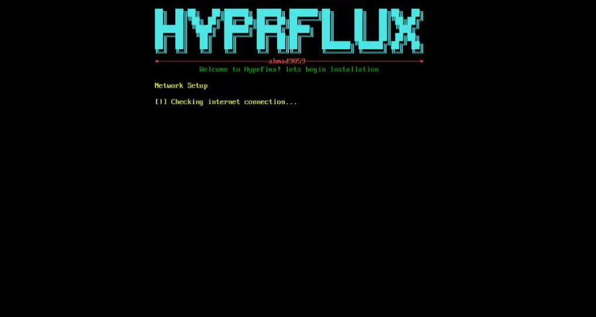
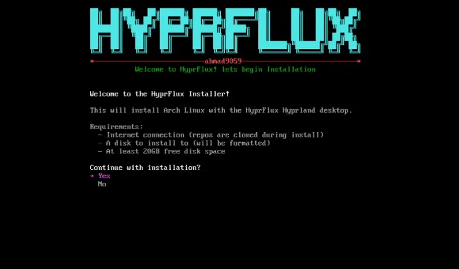
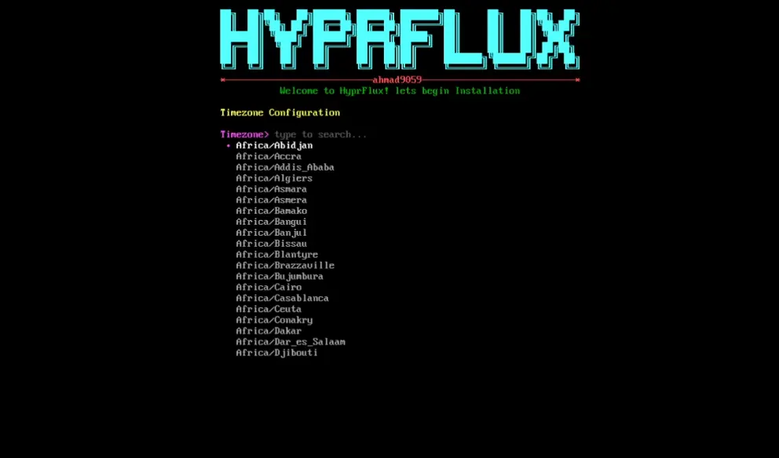
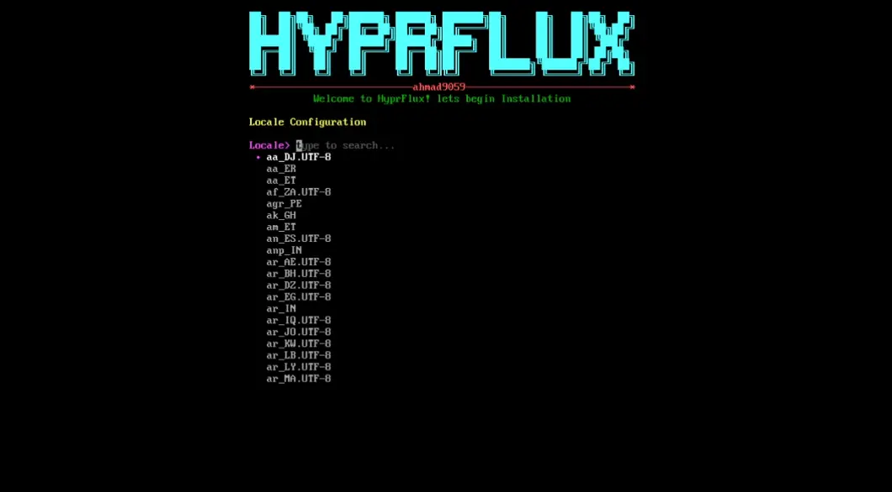
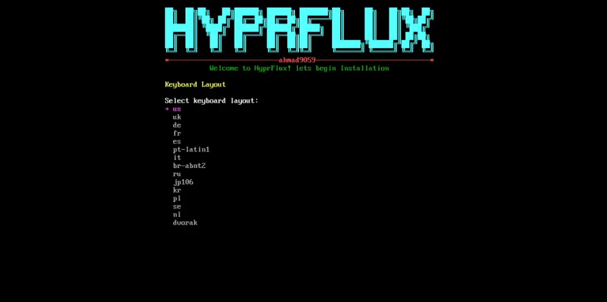
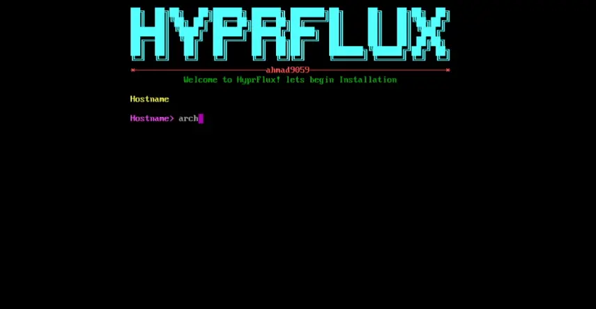
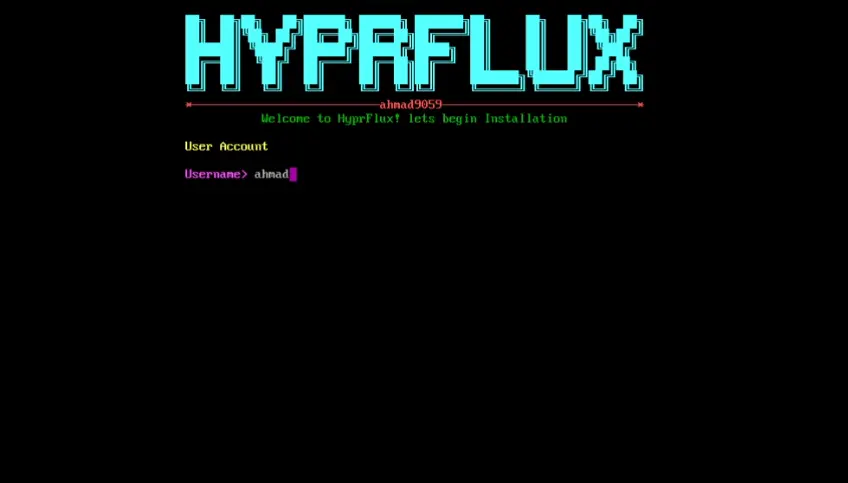

# Install HyprFlux from the ISO (Complete Procedure)

**Goal:** install a complete HyprFlux desktop on a computer that does not have Arch Linux yet, using the bootable ISO. This page covers automatic and manual partitioning, plus what to do when a step does not go as expected.

::: tip New to HyprFlux?
If this is your first install and you do not need manual partitioning, follow the [guided tutorial](/general/quickstart) instead. It walks the same installer using automatic partitioning.
:::

The HyprFlux ISO installs an Arch Linux base and provisions the complete HyprFlux desktop before the final reboot. It is an online installer, so it needs network access throughout.

## Prerequisites

- An x86_64 computer.
- At least 4 GB of RAM, though 8 GB or more is recommended.
- At least 20 GB of target storage. The disk selector recommends about 25 GiB or more.
- A USB drive large enough for the ISO.
- An internet connection that allows the installer's connectivity check and its package downloads.

The installer displays this storage guidance but does not enforce a minimum. Leave room for applications and personal files.

## Download and verify

Download the latest `.iso` and the matching `.sha256` file from the canonical [HyprFlux release](https://github.com/ahmad9059/HyprFlux/releases/latest). Alternative mirrors are listed on the [download page](/general/download).

Put both files in the same directory and verify them before writing the USB drive:

```bash
sha256sum -c hyprflux-*.iso.sha256
```

Continue only when the output reports `OK`. Do not verify an ISO with a checksum from another release channel.

## Create the bootable USB

::: warning The selected USB device is erased
`dd` writes to the entire destination device. Confirm the device with `lsblk` and replace `/dev/sdX` with the USB device, not one of its partitions. Choosing the wrong device destroys its data.
:::

```bash
lsblk
sudo dd bs=4M if=hyprflux-*.iso of=/dev/sdX status=progress oflag=sync
```

You can also use [balenaEtcher](https://etcher.balena.io/) or another tool that writes the raw ISO image.

## Boot the ISO

1. Insert the USB drive and open your firmware boot menu.
2. Select the USB device.
3. Choose the normal HyprFlux installer. A copy-to-RAM option is also available.

The image supports UEFI through GRUB and legacy BIOS through Syslinux.


The live environment signs in as root on `tty1` and starts the text installer automatically. If you exit the installer, you are left at a root shell.

## Installation flow

### 1. Network check

The installer requires a successful ping to `1.1.1.1`. Ethernet normally uses NetworkManager and DHCP. There is no Wi-Fi picker inside the installer. If the check fails, the installer exits to the shell and tells you to run:

```bash
nmtui
```

After you connect, restart the installer:

```bash
bash ~/hyprflux-install.sh
```



### 2. Welcome and confirmation

Review the requirements and confirm that you intend to install Arch Linux and HyprFlux. This step does not erase a disk yet.



### 3. Regional settings

Select the timezone, regional locale, and console keyboard layout.

- Timezone detection may suggest a value based on your network.
- The locale selection controls regional date and time formatting. The installed system language stays `en_US.UTF-8`.
- Cancelling these selectors uses documented fallback values.







### 4. Hostname and user

Choose a hostname, then create a lowercase username and a password. The installer asks for a username, not a separate full name. Keep the password: it is used for both the normal account and the root account on the installed system.





### 5. Choose a disk method


**Automatic mode** creates a GPT/ext4 installation and erases the entire selected disk. UEFI systems get an EFI System Partition, and BIOS systems get a BIOS Boot partition. Swap is optional.

Before erasing anything, the installer shows the selected device and requires you to type the exact lowercase word `yes`. Destruction starts immediately after that confirmation, when it clears the partition table and filesystem signatures.

::: warning Automatic mode destroys the selected disk
Back up all required data and verify the device model, path, and size. The installer cannot undo the wipe.
:::

**Manual mode** opens an unrestricted root shell so you can partition, format, and mount storage yourself. Mount root at `/mnt/archinstall`. On UEFI, mount the EFI System Partition at `/mnt/archinstall/boot`.

Manual mode is an expert workflow. The installer checks only that the required mountpoints are mounted. It does not validate filesystem types, partition flags, available capacity, encryption, dual-boot safety, or that all mounts belong to the intended device.

### 6. Install and configure Arch Linux

The installer selects mirrors and runs `pacstrap`. It then writes a UUID-based `fstab` and configures timezone, locale, keyboard, hostname, users, sudo, pacman, NetworkManager, initramfs, and GRUB inside the target system. Package and mirror operations may be retried automatically.

### 7. Provision HyprFlux in the chroot

Before rebooting, the ISO fetches the HyprFlux revision pinned by that ISO release and runs the desktop provisioning inside the target system. This stage installs the base desktop and AUR packages, runs the numbered HyprFlux modules, configures SDDM, Bluetooth, and networking, and selects the graphical boot target.

The installer then rebuilds and checks the initramfs and validates the root UUID used by GRUB. A failed boot check prevents the automatic reboot.

### 8. Final reboot

On success, remove the USB drive or detach the ISO and press Enter. The installer syncs data, unmounts the target, disables swap, verifies cleanup, and reboots.

Full HyprFlux provisioning finishes before this reboot. Current releases do not reboot into a TTY to ask for package groups or start a second desktop installer.

## First desktop login

Boot the installed system and sign in through SDDM with the account you created during installation. At the first desktop login, a small fixup:

- applies GTK, icon, cursor, font, and dark-mode settings
- applies `nwg-look` settings
- enables the PipeWire and WirePlumber user services
- retries any AUR packages that were recorded as missing.

If packages are still unavailable, that retry runs again on a later login. The installer does not configure automatic login.

## Verify your installation

The installation is successful once you can sign in through SDDM and reach a working Hyprland desktop. If SDDM does not offer a session, or the desktop does not start, do not rerun the installer yet. Check the logs below first, because a rerun replaces some of your managed state.

## If something goes wrong

After installation, inspect the retained HyprFlux-stage logs with:

```bash
less "$HOME/HyprFlux/logs/iso-wrapper.log"
less "$HOME/HyprFlux/logs/first-boot-aur.log"
ls -la "$HOME/HyprFlux/logs" "$HOME/HyprFlux/logs/installer"
```

The first-boot AUR log exists only after that fixup runs. Early partitioning, formatting, and `pacstrap` progress logs are temporary and are not guaranteed to survive a failed live session.

If the installer exits before it modifies storage, correct the reported problem and restart it with `bash ~/hyprflux-install.sh`. Once partitioning has started, do not rerun or reformat blindly. Record the error and inspect the current mounts and devices before you take further action.

For help, open a [HyprFlux issue](https://github.com/ahmad9059/HyprFlux/issues) and include the ISO release, firmware mode, installation stage, device layout, and any retained logs. The [troubleshooting guide](/general/troubleshooting) covers the installed desktop and its services.
