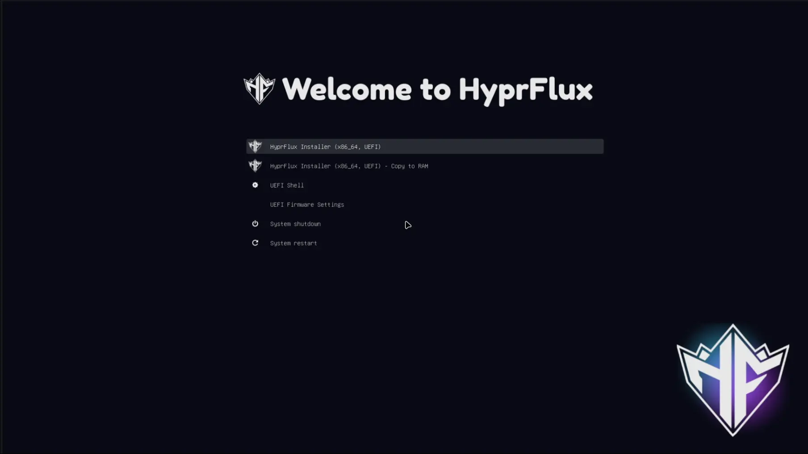
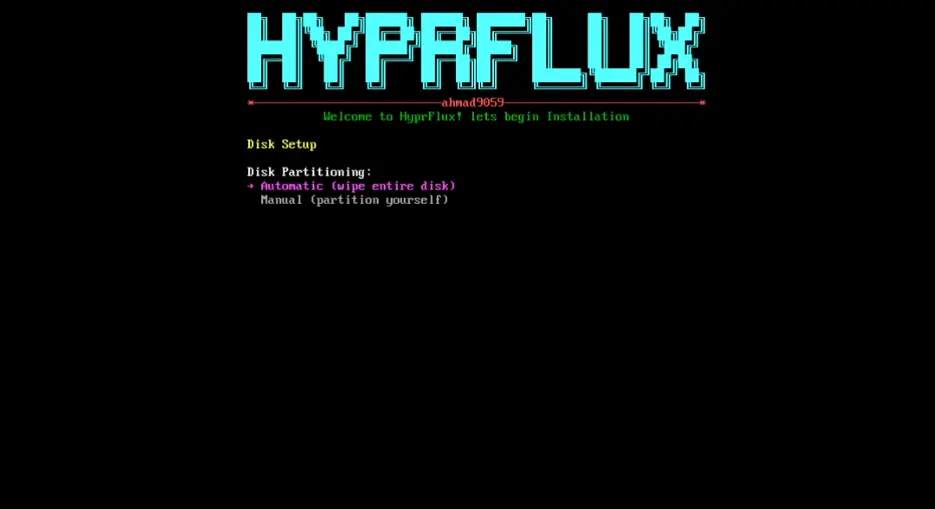

# Install HyprFlux for the First Time

This tutorial installs HyprFlux on a computer that does not have Arch Linux yet. You boot from a USB drive, the installer sets up Arch Linux and the HyprFlux desktop, and you sign in for the first time. No prior Arch or Hyprland experience is needed.

::: info Already have Arch Linux?
This tutorial installs Arch Linux for you. If Arch is already on your system, follow the [existing-Arch installation guide](/general/installation) instead.
:::

## Before you start

You need:

- An x86_64 computer with at least 4 GB of RAM (8 GB or more is better) and at least 20 GB of free storage.
- A USB drive large enough to hold the ISO.
- An internet connection. The installer downloads packages during setup.

::: warning This erases a disk
The installer erases the whole disk you select. Use a spare machine or a virtual machine if you are unsure, and back up anything important first.
:::

For the full requirements, see the [complete ISO installation guide](/general/iso-installation#prerequisites).

## Step 1: Download and verify the ISO

Download the latest HyprFlux ISO and its matching `.sha256` file from the [HyprFlux releases page](https://github.com/ahmad9059/HyprFlux/releases/latest). Put both files in the same folder, then verify the ISO:

```bash
sha256sum -c hyprflux-*.iso.sha256
```

Wait for the command to print `OK` before you continue. If it does not, download the ISO again. See the [download guide](/general/download) if you would rather use a mirror.

## Step 2: Write the ISO to a USB drive

Find your USB drive with `lsblk`, then write the ISO to it:

```bash
lsblk
sudo dd bs=4M if=hyprflux-*.iso of=/dev/sdX status=progress oflag=sync
```

::: warning This erases the USB drive
`dd` writes to the whole device, not a partition. Check `/dev/sdX` before you run this. The wrong device name destroys its data.
:::

[balenaEtcher](https://etcher.balena.io/) works too if you prefer a graphical tool.

## Step 3: Boot the ISO

Insert the USB drive, restart the computer, and open the firmware boot menu. Select the USB device.



Choose the normal HyprFlux installer option. The boot splash appears, then the installer signs you in automatically and starts:


## Step 4: Follow the installer

The installer walks through several screens:

1. **Network check.** The installer confirms it can reach the internet. If this fails, it drops you to a shell. Run `nmtui` to connect, then restart the installer with `bash ~/hyprflux-install.sh`.
2. **Welcome and confirmation.** Review the requirements and confirm that you want to continue. Nothing is erased yet.
3. **Regional settings.** Pick your timezone, locale, and keyboard layout.
4. **Hostname and user.** Choose a hostname, a lowercase username, and a password. The password is used for your account and the root account.
5. **Disk method.** Choose **Automatic**. It partitions the whole selected disk (GPT with ext4, plus the correct boot partition for your firmware) and asks you to type `yes` before it erases anything.

   

   ::: warning Automatic mode erases the selected disk
   Check the device name, path, and size before you type `yes`. This cannot be undone.
   :::

   There is also a **Manual** option for partitioning the disk yourself. The [complete ISO installation guide](/general/iso-installation#_5-choose-a-disk-method) covers that path.

From here the installer takes over. It installs the Arch Linux base system, then provisions the full HyprFlux desktop: packages, services, themes, and configuration. This takes a while, so let it run.

## Step 5: Reboot

When the installer finishes, remove the USB drive and press Enter. It syncs data, unmounts everything, and reboots.

## Step 6: Sign in

After the reboot, sign in through SDDM with the username and password you created. On this first login, HyprFlux finishes a few setup steps in the background: it applies your GTK, icon, cursor, and font settings and starts the audio services. Give it a moment before everything feels settled.

## You are done

You now have a working HyprFlux desktop: Hyprland as the window manager, plus Waybar, Rofi, SwayNC, and the rest of the default stack, configured and running.

## Next steps

- [Hyprland keybindings](/keybindings/hyprland). Learn the shortcuts before you start navigating.
- [Features](/features/hyprland). See what each part of the desktop does.
- [Configuration](/hyprland/hyprland). Customize your setup.
- [Troubleshooting](/general/troubleshooting). Use this if something does not work as described here.
- [Existing-Arch installation](/general/installation). The guide to use next time, if you install HyprFlux on a system that already runs Arch Linux.

If you hit a problem this tutorial does not cover, open a [GitHub issue](https://github.com/ahmad9059/HyprFlux/issues) and include the step you were on and the relevant files from `~/HyprFlux/logs/`.
